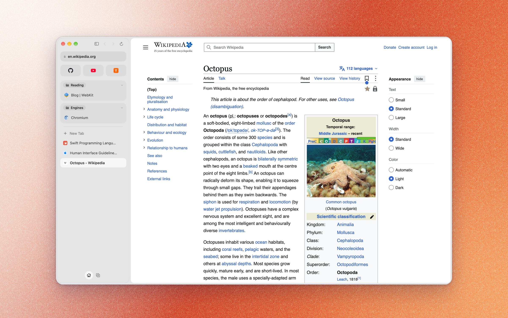

<p align="center">
  
</p>

<h1 align="center">Ikago</h1>

<p align="center">
  A native macOS browser with Spaces, split view, extensions and your choice of engine.
</p>

<p align="center">
  
</p>

Built with **Swift 6, AppKit and SwiftUI**, using **Chromium (CEF)** or **Apple’s WebKit**.

> I’m building Ikago to learn and to have the browser features I want, the way I want them.
> It’s a slow project, but it’s fun. I hope others can take inspiration from it or learn
> something along the way too.

## Features

- **Browsing:** Spaces, tab groups, pinned tabs, bookmarks and split view with up to four pages.
- **Layouts:** a sidebar or top tabs, with customizable controls and colors.
- **Engines:** choose WebKit or Chromium as your default, with optional per-site rules.
- **Extensions:** Chrome Web Store installs and Safari extensions; compatibility varies by engine.
- **Privacy:** isolated Space storage, tracker blocking, HTTPS by default and private windows.
- **Your data:** encrypted history and sessions, a password vault with Touch ID, and browser imports.

Still a work in progress. Passkeys, address and card autofill, and syncing Spaces between Macs
are unfinished; protected video (DRM) requires WebKit. See the [roadmap](ROADMAP.md).

## Download

Get the latest DMG from [Releases](https://github.com/FraudMomo/Ikago/releases/latest). It needs
**macOS 26+** on **Apple Silicon**, is signed and notarized by Apple, and updates itself.

## Build and install

Requires **macOS 26+**, **Apple Silicon**, **Xcode 26+**, CMake and Ninja.

```sh
brew install cmake ninja
python3 scripts/build.py
open build/Ikago.app
```

The first build downloads and verifies the pinned CEF SDK. Chromium itself is never compiled.
Builds use an Apple Development signing identity when available, otherwise ad hoc signing.

To build and install into `/Applications`:

```sh
scripts/install.sh
```

## Development

Use `--flavor debug` for the WebKit test driver or `--flavor checks` for the Chromium suite.
Release builds exclude test code. Test fixtures use disposable storage.

- [Contributing](CONTRIBUTING.md) — development commands, tests and contribution guidelines.
- [Architecture](AGENTS.md) — project structure, engine boundaries and design rules; area details in [docs/agents](docs/agents).
- [Security](SECURITY.md) — security model and vulnerability reporting.

## Privacy

No Ikago accounts, analytics or telemetry. Browsing data stays on your Mac; phishing lists
are matched locally, and remote search suggestions are opt-in.

## License

[MIT](LICENSE). See [third-party notices](THIRD_PARTY_NOTICES.md) for bundled components.
