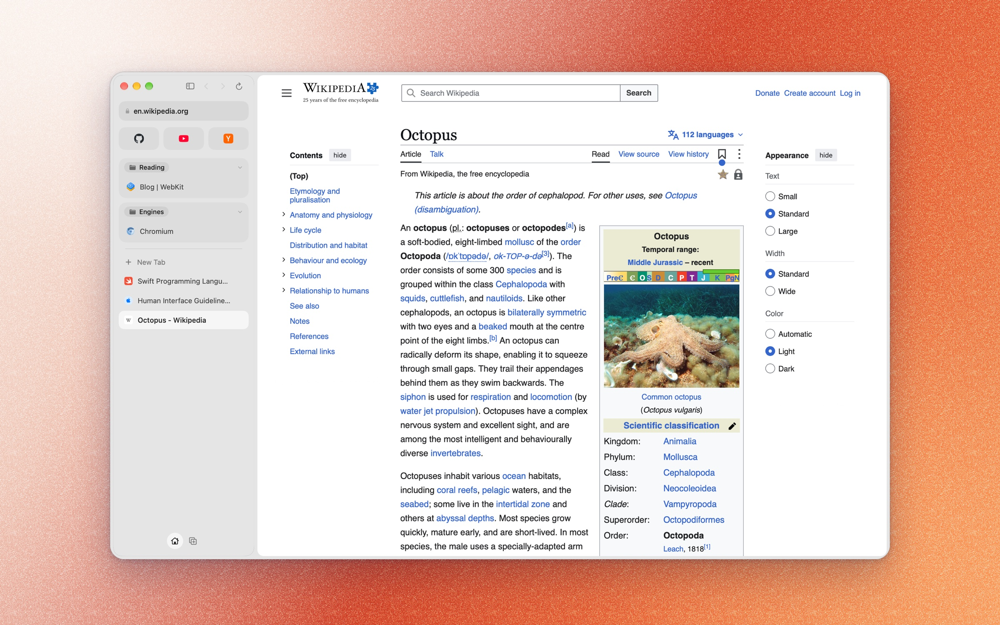

<p align="center">
  
</p>

<h1 align="center">Ikago</h1>

<p align="center">
  A native macOS browser with Spaces, split view, web extensions and a choice of engine.
</p>

<p align="center">
  
</p>

---

Ikago is written in **Swift 6 with AppKit and SwiftUI**. Pages render with **Chromium**, through
a prebuilt Chromium Embedded Framework (CEF), or with **Apple's WebKit**. You choose on first
launch, and either way Ikago draws every pixel of its own interface.

> **A personal side project.** Ikago is something I build for myself, for macOS only. It isn't
> finished, it has no stable release, and I don't expect anyone to switch to it as their main
> browser. It's here to show the work and to learn from. Feedback, ideas and bug reports are
> very welcome. Open an issue.

## Highlights

- **Two engines, one browser.** Ikago runs Chromium and Apple's WebKit side by side. Choose a default,
  or send individual sites to the engine that suits them. A tab switches engines mid-browse when you
  follow a link, and your sign-ins move with the site, so you stay logged in.
- **Cookie jars per Space and per site.** A Space can keep its own cookies, logins and site storage,
  so work and personal accounts live side by side in one window. Within a Space, sites can't follow
  you either, on both engines:
  - Third-party cookies are blocked outright, so an embedded tracker can't read or set any.
  - Other storage an embedded site uses (localStorage, IndexedDB) gets a separate jar for each
    website you visit, so it can't link your activity across sites.
- **Your data locked to Ikago.** History, sessions and site data live in a container macOS keeps
  other apps out of, and the sensitive files are encrypted with a key in your Keychain. Saved
  passwords are encrypted to the Secure Enclave, and every single fill asks for Touch ID.
- **Split view, up to four pages.** Drag a tab onto the page to split it, and arrange the panes as
  columns, rows or a grid. Each split stays together in the sidebar and comes back with your session.
- **Extensions on both engines.** Chrome Web Store extensions are signature-checked the way Chrome
  checks them, then installed on both engines and kept in sync between them.
- **X videos play on Chromium.** Open-source Chromium can't decode the H.264 video X serves. Ikago
  steps into X's own player and re-encodes each segment to AV1 on your Mac, using VideoToolbox and
  SVT-AV1, sized to the video's on-screen size. When nothing is urgent, the work runs on the
  efficiency cores.

## What's there and what's missing

| Area | Working today | Not yet |
| --- | --- | --- |
| **Browsing** | Sidebar and Top Bar layouts, Spaces, tab groups, pinned tabs, split view (up to 4), command bar, full screen | Tab sync across devices |
| **Engines** | WebKit and Chromium, per-site engine rules, sign-ins that follow a site | Protected video (DRM) on Chromium; it plays on WebKit |
| **Extensions** | Chrome Web Store installs (signature-verified), Safari extensions, uBlock Origin Lite by default | Full extension API coverage, native messaging |
| **Passwords** | Vault with Touch ID on every fill, import from Apple Passwords or Chrome | Saving new logins, passkeys |
| **Privacy** | HTTPS by default, tracker blocking, third-party cookie blocking, phishing warnings, encrypted history | Live Safe Browsing |
| **Import** | Bookmarks, history, tabs, groups and logins from other browsers | Safari cookies and open tabs |
| **Distribution** | Builds and installs from source | Notarized releases and app updates |
| **AI agents** | | Built-in MCP server for agents ([planned](ROADMAP.md)) |

The [roadmap](ROADMAP.md) has the full picture.

## Features

**Browsing**
- **Two layouts:** a Sidebar (full, a rail of icons, or hidden) and a Top Bar with Separate or Compact tabs
- **Spaces:** separate sets of tabs, pinned tabs and groups, each with its own colors and optionally its own website data
- **Split view:** up to four pages side by side as columns, rows or a grid, made by dragging a tab onto the page
- **Address field:** ranked suggestions from history, bookmarks, open tabs and search, with inline completion
- **Library:** History, Downloads and Bookmarks open as pages in tabs, with nested bookmark folders and a bookmarks bar
- **Settings:** a simple, searchable set of pages, with a short welcome on first launch

**Engines and extensions**
- **Engine choice:** WebKit or Chromium, chosen globally or per site, and sign-ins move with you when you switch
- **Extensions:** install from the Chrome Web Store, from a package file, or from Safari extensions on this Mac

**Security and privacy**
- **Privacy:** HTTPS by default, tracker blocking, blocked third-party cookies, phishing warnings and private windows
- **Passwords:** a built-in vault that encrypts each login to the Secure Enclave and asks for Touch ID before every fill
- **Import:** bring bookmarks, history, open tabs and sign-ins from other browsers installed on this Mac

## Requirements

- macOS 26 or later on Apple Silicon
- Xcode 26 or later
- CMake and Ninja: `brew install cmake ninja`

The first build downloads the CEF distribution pinned in [`CEF/cef-lock.json`](CEF/cef-lock.json)
and verifies its checksum. Chromium itself is never compiled.

## Building

```sh
python3 scripts/build.py                  # build/Ikago.app: optimized, no test code
open build/Ikago.app
```

| Flavor | Output | Contents |
| --- | --- | --- |
| `release` (default) | `build/Ikago.app` | Optimized app with no test code |
| `debug` | `build/debug/Ikago.app` | Adds the scripted WebKit test driver |
| `checks` | `build/checks/Ikago.app` | Adds the Chromium runtime checks |

Builds are signed with your Apple Development identity when one is available, or ad hoc
otherwise. Set `IKAGO_SIGN_IDENTITY` to choose a specific identity. A team-signed build
stores its data in a protected app group container. An ad hoc build uses
`~/Library/Application Support/Ikago`.

To build and install into `/Applications`:

```sh
scripts/install.sh
```

## Project layout

| Path | Contents |
| --- | --- |
| `Ikago/App` | Entry point, app delegate, menus and keyboard shortcuts, protected storage |
| `Ikago/Browser` | Model and state with no views: tabs, Spaces, sessions, address suggestions, downloads, favicons, passwords |
| `Ikago/Engine` | Page engines behind the `WebTab` protocol: `Shared`, `WebKit` and `Chromium` |
| `Ikago/Extensions` | Web extension support for each engine, Web Store installs and package verification |
| `Ikago/Import` | Importing data from other browsers and exported files |
| `Ikago/UI` | Windows, sidebar, top bar, tabs, address field, overlays, settings and internal pages |
| `Ikago/Checks` | Runtime checks and the scripted test driver; excluded from release builds |
| `CEF` | Objective-C++ bridge to CEF, CMake build and the pinned SDK version |
| `scripts` | Build, packaging, installation, dependency updates and check runners |

[AGENTS.md](AGENTS.md) documents the architecture rules and conventions in detail. Read it
before making changes.

## Testing

Debug builds include a scripted test driver. With `IKAGO_TEST_MODE=1`, Ikago uses in-memory
website data and a temporary session folder, so your own profile is never touched.
`IKAGO_TEST_ACTIONS` drives the app through the same command paths as its menus:

```sh
IKAGO_TEST_MODE=1 IKAGO_TEST_ACTIONS="wait:4;new:https://example.com/;split;wait:3;dump;quit" \
  build/debug/Ikago.app/Contents/MacOS/Ikago
```

`dump` prints model and page state as a single `IKTEST {json}` line. All actions are
listed in [`TestDriver.swift`](Ikago/Checks/Debug/TestDriver.swift) and
[`TestDriver+Checks.swift`](Ikago/Checks/Debug/TestDriver+Checks.swift).

Run the WebKit feature checks against a local fixture server:

```sh
scripts/check-browser-features.sh
```

Run the Chromium suite. It uses disposable profiles and a mock keychain, and keeps every
Chromium window hidden:

```sh
python3 scripts/build.py --flavor checks
python3 scripts/run_chromium_checks.py
```

## Data and privacy

Ikago keeps your data on your Mac. It has no accounts, analytics or telemetry.

- History, sessions, download history and favicons are encrypted at rest with AES-GCM. The key is kept in the login Keychain.
- Saved passwords are encrypted to a Secure Enclave key, and each fill requires Touch ID or your Mac password.
- Phishing lists are downloaded and matched locally. The addresses you visit are never sent anywhere.
- Remote search suggestions are off unless you turn them on.

See [SECURITY.md](SECURITY.md) for the security model and how to report a vulnerability.

## Contributing

Contributions are welcome. Please read [CONTRIBUTING.md](CONTRIBUTING.md) and
[AGENTS.md](AGENTS.md) first.

## License

Ikago is released under the [MIT License](LICENSE). Third-party components are listed in
[THIRD_PARTY_NOTICES.md](THIRD_PARTY_NOTICES.md).
